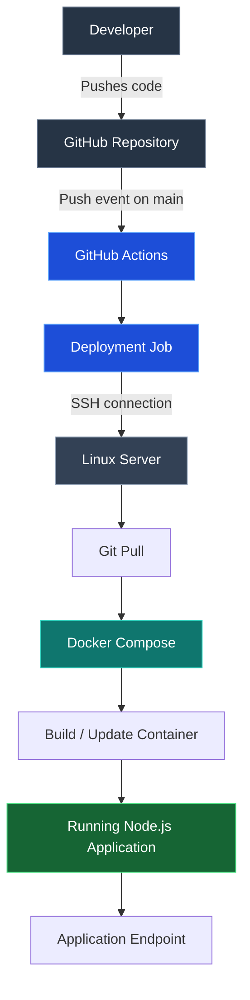

# Node.js Application Deployment with Docker & GitHub Actions

A practical deployment project demonstrating how to containerize a Node.js application and automate its deployment using GitHub Actions.

The objective is to establish a repeatable deployment workflow: changes are pushed to GitHub, the CI/CD pipeline is triggered, and the application is rebuilt and deployed on a Linux server.

## Overview

This project brings together a few essential DevOps practices:

- **Node.js & Express** — application runtime and web framework.
- **Docker** — packages the application and its dependencies into a container.
- **Docker Compose** — simplifies container configuration and lifecycle management.
- **GitHub Actions** — automates the deployment workflow whenever changes are pushed to the main branch.
- **Linux** — provides the environment for running and managing the application.

## Architecture

The intended deployment workflow is illustrated below.



## Deployment Workflow

The deployment process is designed around the following sequence:

1. Application code is maintained in a GitHub repository.
2. A push to the `main` branch triggers the GitHub Actions workflow.
3. The workflow connects to the deployment server over SSH.
4. The latest application changes are retrieved from the repository.
5. Docker Compose rebuilds the application image and starts the updated container.
6. The updated application becomes available through its configured endpoint.

SSH credentials are supplied through GitHub Actions Secrets rather than being stored in the repository.

## Project Structure

```text
nodejs-application-deploy/
│
├── .github/
│   └── workflows/
│       └── deploy.yml
│
├── Dockerfile
├── docker-compose.yml
├── package.json
├── package-lock.json
├── index.js
└── README.md
```

## Running the Application Locally

### Prerequisites

- Node.js
- npm
- Docker Engine
- Docker Compose

### Option 1: Run directly with Node.js

Clone the repository:

```bash
git clone <YOUR_REPOSITORY_URL>
cd nodejs-application-deploy
```

Install dependencies and start the application:

```bash
npm install
npm start
```

### Option 2: Run using Docker Compose

Build and start the application:

```bash
docker compose up -d --build
```

Check running containers:

```bash
docker compose ps
```

View application logs:

```bash
docker compose logs -f
```

Stop the application:

```bash
docker compose down
```

## CI/CD Configuration

The GitHub Actions workflow is configured to trigger on pushes to the `main` branch.

The deployment process uses SSH authentication to connect to the target Linux server.

The following repository secrets are required:

| Secret | Purpose |
|---|---|
| `SSH_HOST` | Public IP address or hostname of the server |
| `SSH_KEY` | Private SSH key used by the deployment workflow |

The corresponding public key must be configured in the deployment user's `authorized_keys` file on the server.

## Security Considerations

- Private SSH keys are stored in GitHub Actions Secrets.
- Private credentials are not committed to the repository.
- Deployment should use a dedicated, non-root Linux account.
- Server access should be restricted to the required ports and services.

## What This Project Demonstrates

This project provides practical exposure to:

- Linux server administration.
- Git-based source code management.
- Containerization using Docker.
- Application deployment using Docker Compose.
- CI/CD pipeline configuration with GitHub Actions.
- SSH-based remote deployment.
- Basic application and container management.
